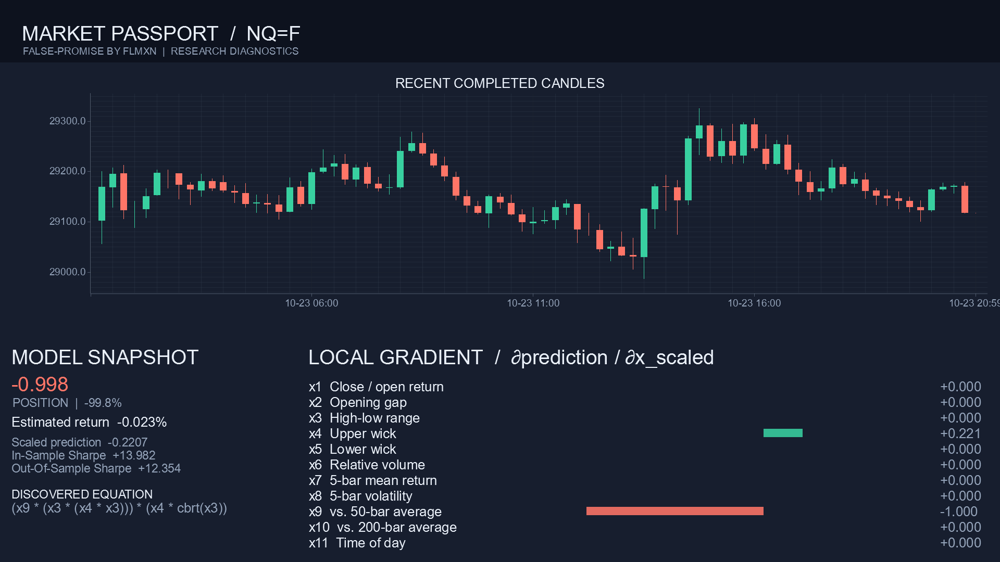

<div align="center">


# False Promise

<p>
  <a href="LICENSE"></a>
  
  
  <a href="https://github.com/FLMxN/false-promise/stargazers"></a>
</p>

Open-source quantitative finance research tool for NASDAQ via Yahoo Finance data, powered by Rust and Julia.

> "The odds are with us. *Or are they*?" — ***Oracle, Dota 2***

</div>

> [!WARNING]
> False Promise is experimental research software, not a trading system or financial advice. Market data may be incomplete, and model outputs are, in essence, unvalidated estimates. Manage your money mindfully.

## Table of contents

- [Overview](#overview)
  - [Pipeline at a glance](#pipeline-at-a-glance)
- [Project layout](#project-layout)
- [Requirements](#requirements)
  - [Rust](#rust)
  - [Julia](#julia)
  - [Install Julia packages](#install-julia-packages)
  - [Configure Julia path](#configure-julia-path)
- [Quick start](#quick-start)
  - [Run predictions](#run-predictions)
  - [Logging](#logging)
- [How it works](#how-it-works)
- [Market data](#market-data)
  - [Ticker classification](#ticker-classification)
  - [Completed candles](#completed-candles)
- [Features and target](#features-and-target)
  - [Feature set](#feature-set)
  - [Prediction target](#prediction-target)
- [Model and inference](#model-and-inference)
  - [Training and feature scaling](#training-and-feature-scaling)
  - [Symbolic-regression search](#symbolic-regression-search)
  - [Position signal](#position-signal)
  - [Reported diagnostics](#reported-diagnostics)
- [Checkpoints and output](#checkpoints-and-output)
  - [Model cache](#model-cache)
  - [Market passport](#market-passport)
- [Tests](#tests)
- [License](#license)

## Overview

False Promise is an experimental **market-research pipeline**. It fetches completed candles from Yahoo Finance, prepares a volatility-scaled dataset, and uses Julia's symbolic-regression engine to search for a candidate equation. Rust evaluates that equation against the latest completed candle and reports a bounded position signal with research diagnostics.

### Pipeline at a glance

| Stage | Component | Responsibility |
|---|---|---|
| **1 · Data** | Yahoo Finance | Supplies quotes and historical candles |
| **2 · Features** | Rust | Validates candles and builds the training dataset |
| **3 · Search** | Julia | Searches for a symbolic equation and calculates model metrics |
| **4 · Inference** | Rust | Evaluates the equation and reports the latest prediction |

Rust and Julia communicate using JSON over standard input and output:

```text
Yahoo Finance → Rust data pipeline → Julia symbolic regression
                         ↑                    ↓
                   prediction ← equation and model metrics
```

The Julia entry point is [`src/engine.jl`](src/engine.jl). It uses [`src/mathtools.jl`](src/mathtools.jl) and [`src/chaintools.jl`](src/chaintools.jl); the Rust application and market-passport renderer live in [`src/main.rs`](src/main.rs) and [`src/graph.rs`](src/graph.rs).

## Project layout

- [`src/main.rs`](src/main.rs) — data fetching, feature engineering, checkpoint handling, Julia invocation, and prediction reporting.
- [`src/engine.jl`](src/engine.jl) — Julia model discovery and in-/out-of-sample metrics.
- [`src/mathtools.jl`](src/mathtools.jl) and [`src/chaintools.jl`](src/chaintools.jl) — feature scaling, search configuration, scoring, and input validation.
- [`src/diff.rs`](src/diff.rs) — local equation gradients.
- [`src/graph.rs`](src/graph.rs) — PNG market-passport rendering.
- `checkpoints/` — cached model results, created as the app runs.
- `graphs/` — generated market passports, created as the app runs.

## Requirements

| Requirement | Details |
|---|---|
| **Rust** | Rust and Cargo with support for the 2024 edition |
| **Julia** | `julia` on `PATH`, or the executable configured with `JULIA_PATH` |
| **Julia packages** | `JSON3`, `SymbolicRegression`, `LoopVectorization`, and `ConstructionBase` |
| **Network** | Internet access for Yahoo Finance quotes and candle history |

### Rust

The Rust project uses edition **2024**. Cargo resolves and builds its dependencies on the first run.

### Julia

Julia runs the symbolic-regression engine. Install its packages in the Julia environment that the application will use.

### Install Julia packages

Run this in Julia:

```julia
using Pkg
Pkg.add(["JSON3", "SymbolicRegression", "LoopVectorization", "ConstructionBase"])
```

### Configure Julia path

If Julia is not on `PATH`, set `JULIA_PATH` to its executable. In PowerShell:

```powershell
$env:JULIA_PATH = "C:\path\to\julia.exe"
```

On macOS or Linux, set the environment variable in your shell:

```bash
export JULIA_PATH=/path/to/julia
```

## Quick start

### Run predictions

From the repository root, pass one or more Yahoo Finance ticker symbols:

```bash
cargo run -- AAPL
cargo run -- BTC-USD ETH-USD
cargo run -- ES=F EURUSD=X ^GSPC
```

The first run compiles the Rust application. Tickers are processed in the order supplied.

### Logging

Pass `--debug` to enable debug-level application logs:

```bash
cargo run -- --debug AAPL
```

Alternatively, set the Rust log filter directly. In PowerShell:

```powershell
$env:RUST_LOG = "debug"
cargo run -- AAPL
```

On macOS or Linux:

```bash
RUST_LOG=debug cargo run -- AAPL
```

> [!NOTE]
> A ticker is skipped if it has fewer than **50 valid training samples** or the latest completed candle does not have a valid feature vector.

## How it works

For each ticker, the pipeline:

1. Fetches the latest quote and candle history using `yfinance-rs`.
2. Keeps completed candles, sorts and deduplicates them, and rejects invalid OHLCV data.
3. Builds 11 features and pairs each feature row with the following candle's volatility-scaled return.
4. Reuses a valid checkpoint when available; otherwise, sends the dataset to Julia for symbolic regression.
5. Scales the latest feature vector with the model's training bounds, evaluates the discovered equation, and reports the prediction, position, and diagnostics.

## Market data

### Ticker classification

The asset type is inferred from the ticker symbol. It determines the requested Yahoo Finance history range and candle interval:

| Asset type | Symbol pattern | History requested | Candle interval |
|---|---|---:|---:|
| Futures | Contains `=F` | 1 month | 15 minutes |
| Currency | Contains `=X` | 3 months | 30 minutes |
| Crypto | Ends in `-USD` or `-USDT` | 6 months | 1 hour |
| Index | Contains `^` | 2 years | 4 hours |
| Stock | Any other symbol | 1 year | 1 hour |

### Completed candles

Only candles whose full interval has elapsed are included. Invalid OHLCV candles break the feature and target sequence; data is not bridged across invalid records.

## Features and target

### Feature set

For each candle with sufficient history, Rust calculates **11 features**, grouped below by the kind of market information they describe:

**Price action · Features 1–5**

| # | Feature | Description |
|---:|---|---|
| 1 | Close-to-open return | `(close - open) / open` |
| 2 | Opening gap | `(open - previous close) / previous close` |
| 3 | High-low range | `(high - low) / close` |
| 4 | Upper wick | `(high - max(open, close)) / close` |
| 5 | Lower wick | `(min(open, close) - low) / close` |

**Volume and short-term behavior · Features 6–8**

| # | Feature | Description |
|---:|---|---|
| 6 | Relative volume | Volume divided by the mean of up to the preceding 20 candles |
| 7 | Five-candle mean return | Mean of the latest five close-to-close returns |
| 8 | Five-candle volatility | Population standard deviation of those five returns |

**Market context · Features 9–11**

| # | Feature | Description |
|---:|---|---|
| 9 | Distance from 50-candle mean | `close / mean(close, 50) - 1` |
| 10 | Distance from 200-candle mean | `close / mean(close, 200) - 1` |
| 11 | Time of day | UTC hour encoded as `sin(2π × hour / 24)` |

Rows with invalid prices, volume, or derived values are discarded.

### Prediction target

For a feature row at candle *t*, the target is the **next candle's close-to-close return**, scaled by the five-candle volatility measured at *t*:

```text
target_return(t+1)        = (close(t+1) - close(t)) / close(t)
target_scaled_return(t+1) = target_return(t+1) / volatility(t)
```

## Model and inference

### Training and feature scaling

Julia uses the first **80%** of samples for symbolic-regression search and reserves the remainder for out-of-sample evaluation. Each feature is scaled to `[-1, 1]` using its **1st and 99th percentile** training bounds.

### Symbolic-regression search

The search configuration is defined in [`src/mathtools.jl`](src/mathtools.jl):

| Setting | Value |
|---|---|
| Iteration budget | 800 |
| Parallelism | Multithreading |
| Maximum expression size | 12 |
| Maximum expression depth | 5 |
| Binary operators | `+`, `-`, `*` |
| Unary operators | `sqrt`, `cbrt`, `tanh` |

### Position signal

The model centers and scales predictions using their in-sample median and scaled median absolute deviation. A **hyperbolic tangent** maps the resulting value to a bounded position signal:

```text
position = tanh((prediction - prediction_median) / prediction_scale)
```

During candidate scoring, Julia estimates each next-candle return as
`prediction × current_volatility`. It applies a proposed position change only
when its forecast incremental return exceeds the turnover cost (`0.05%` per
unit); otherwise it retains the previous position. The accepted position path
is scored against realized returns with turnover costs included, so decisions
use the model forecast rather than future returns.

### Reported diagnostics

The console report includes:

- **Equation** — the expression selected by symbolic regression.
- **Prediction** — the scaled model output and estimated raw return.
- **Sharpe metrics** — in-sample and out-of-sample results.
- **Local gradient** — the equation's local sensitivity to each scaled feature.

These are exploratory diagnostics, not validated forecasts or recommendations.

## Output and cache

### Market passport

For each successful prediction, the app writes a **1920 × 1080 PNG** market passport to `graphs/<ticker>_passport.png`. It contains:



- Recent completed candles.
- Position and return estimates.
- In-sample and out-of-sample Sharpe metrics.
- The discovered equation.
- The local feature gradient.

Example of CLI output for **NQ=F** as per **25.10.2026, 13:11**:

```text
[2026-10-25T10:11:16Z INFO  false-promise] Model result: token=NQ=F status=accepted samples=1348 reason=None
[2026-10-25T10:11:16Z INFO  false-promise] ###########################################################################################
[2026-10-25T10:11:16Z INFO  false-promise] Equation: (x9 * (x3 * (x4 * x3))) * (x4 * cbrt(x3))
[2026-10-25T10:11:16Z INFO  false-promise] Prediction for NQ=F: position=-0.9982, scaled_return=-0.2207, raw_return=-0.0002
[2026-10-25T10:11:16Z INFO  false-promise] ###########################################################################################
[2026-10-25T10:11:16Z INFO  false-promise] Overfitted: NO
[2026-10-25T10:11:16Z INFO  false-promise] [INS] Sharpe: 13.9817; annualized: 0.0918
[2026-10-25T10:11:16Z INFO  false-promise] [OOS] Sharpe: 12.3538; annualized: 0.0811
[2026-10-25T10:11:16Z INFO  false-promise] ###########################################################################################
[2026-10-25T10:11:16Z INFO  false-promise] Gradient (∂f/∂x_scaled): [0.0, 0.0, 0.0, 0.221, 0.0, 0.0, 0.0, 0.0, -1.0, 0.0, 0.0]
[2026-10-25T10:11:16Z INFO  false-promise] Leading variable: x9 (82%); determination: mid
[2026-10-25T10:11:16Z INFO  false-promise] ###########################################################################################
[2026-10-25T10:11:17Z INFO  false-promise] Passport saved to graphs\NQ_F_passport.png
[2026-10-25T10:11:17Z INFO  false-promise] Pipeline complete
```

> **Generated files:** `checkpoints/`, `graphs/`, `outputs/`, and Rust `target/` contents are ignored by Git.

### Model cache

Model checkpoints are stored in `checkpoints/<ticker>.json`. A cached result is reused only when its model version, accepted status, feature bounds, prediction calibration, history timestamps, and target history match the current dataset. If any of those checks fail, Julia runs again and Rust writes a replacement checkpoint.

## Tests

Run the Rust unit tests from the repository root:

```bash
cargo test
```

## License

Apache-2.0. See [`LICENSE`](LICENSE).
